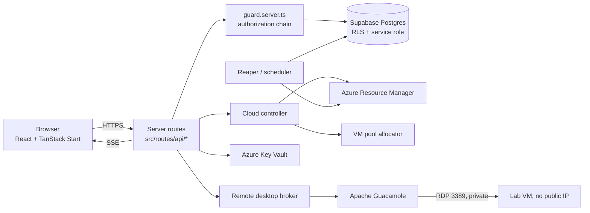

# SkillTrack Labs Platform

Browser-based cloud lab platform. Learners open a branded workspace URL, launch a
published lab, and get a real Windows desktop in the browser — brokered through
Apache Guacamole onto a private Azure VM that has no public IP. Administrators
manage tenants, workspaces, image templates, labs, users, VM pools, sessions and
cost from an operational console.

## Personas

| Persona | Scope | Typical work |
| --- | --- | --- |
| **Super admin** | Whole platform | Cloud connections, Key Vault posture, cost management, VM pool, security console |
| **Admin** | One tenant / its workspaces | Workspaces, templates, labs, users, assignments, sessions, activity |
| **Learner** | Assigned labs only | Home, My Workspace, My Labs, Sessions, Profile — launch, connect, extend, stop |

Roles live in `public.user_roles` (never on the profile row) and are read through
the `public.has_role` / `public.is_admin` security-definer functions.

## Architecture



The browser never talks to Azure, Key Vault or Guacamole's admin API directly.
Every privileged call runs server-side behind the authorization chain
`user -> tenant -> workspace -> lab -> session -> VM`.

## Runtime flows

- **Authentication** — Supabase auth (Microsoft/Entra optional). Tokens are
  verified server-side in `src/lib/security/identity.server.ts`; principals carry
  role, tenant and workspace capabilities.
- **Tenant / workspace / lab management** — admin console under `/admin/*`, backed
  by catalog repositories in `src/lib/db/*.repo.server.ts`.
- **Lab launch** — `POST /api/labs/$labId/start` resolves a launch plan from durable
  records, enforces capacity/quota, allocates a VM, persists the session, then starts the VM.
- **VM pool allocation** — atomic `allocate_pool_vm` claim in Postgres, so one machine
  is never handed to two concurrent launches. Dynamic provisioning is flag-gated.
- **Azure start / readiness** — provider polls ARM until the VM is RUNNING and then READY,
  bounded by `LAB_VM_READY_TIMEOUT_MS`; lifecycle events stream to the learner over SSE.
- **Guacamole remote desktop** — per-session RDP connection plus an ephemeral gateway
  account, both deleted when the session ends.
- **Session heartbeat / extend / stop / expiry** — state machine in
  `src/lib/session/state-machine.ts`; countdown, extend and stop in the learner UI.
- **Reaper / orphan cleanup** — `src/lib/vm/pool/reaper.server.ts` runs every 30s under a
  durable lease, deallocating expired sessions and orphaned machines.

See [docs/lab-lifecycle.md](docs/lab-lifecycle.md) for sequence diagrams.

## Tech stack

TanStack Start (Vite, SSR/server routes) · React 19 · TypeScript · Tailwind CSS +
shadcn/ui · Supabase (Postgres, auth, RLS) · Azure Resource Manager · Azure Key
Vault · Apache Guacamole · Vitest + Playwright + GitHub Actions.

## Repository structure

```
src/routes/            file-based routes; src/routes/api/* are server endpoints
src/components/        admin, learner, layout and ui components
src/lib/security/      identity, authorization guard, secrets, Key Vault
src/lib/db/            Supabase repositories (*.repo.server.ts)
src/lib/cloud/         cloud connections, gallery import, controller, audit
src/lib/vm/            orchestrator, providers (mock + azure-live), pool, reaper
src/lib/remote-desktop/ Guacamole broker and simulated desktop service
src/lib/session/       session registry, state machine, client hooks
supabase/migrations/   SQL migrations (schema, RLS, grants, functions)
tests/                 unit, integration, e2e + in-memory doubles
deploy/guacamole/      gateway Docker Compose, NGINX, TLS notes
infra/                 Terraform and Bicep templates
docs/                  architecture, operations, runbooks
```

## Local development

Node 22+. The repository is developed with **npm** (`package-lock.json`, CI uses `npm ci`).

```sh
npm install
cp .env.example .env      # fill in local values; never commit real secrets
npm run dev               # http://localhost:8080
```

With no Azure/Guacamole configuration the app runs in development mode: mock VM
provider and simulated desktop. See [docs/deployment.md](docs/deployment.md).

## Commands

| Command | Purpose |
| --- | --- |
| `npm run dev` | Dev server |
| `npm run build` / `npm run preview` | Production build / preview |
| `npm run lint` / `npm run format` | ESLint / Prettier |
| `npm run typecheck` | TypeScript, no emit |
| `npm run test` | Vitest (unit + integration) |
| `npm run test:unit` / `test:integration` / `test:coverage` / `test:watch` | Focused test runs |
| `npm run test:e2e` | Playwright smoke suite |
| `npm run ci` | lint + typecheck + test + build |

## Deployment

App (TanStack Start) → any Node/edge host; Supabase for data; Guacamole stack from
`deploy/guacamole`; Azure resources from `infra/`. Follow
[docs/runbooks/deploy.md](docs/runbooks/deploy.md) and
[docs/production-readiness-checklist.md](docs/production-readiness-checklist.md).

## Security model

- Every API request passes `authorize()` in `src/lib/security/guard.server.ts`.
- RLS on every public table, plus explicit GRANTs; service-role access is server-only.
- Secrets resolve from Azure Key Vault in staging/production and from the environment locally.
- Startup validation fails fast outside development on missing credentials.
- Lab VMs have no public IP; RDP is reachable only from the Guacamole subnet.
- Audit trails: `public.activity_logs`, security events, cloud audit log.

Details in [docs/security.md](docs/security.md).

## Documentation

| Topic | Document |
| --- | --- |
| Architecture | [docs/architecture.md](docs/architecture.md) |
| Auth & tenancy | [docs/auth-and-tenancy.md](docs/auth-and-tenancy.md) |
| Database & migrations | [docs/database.md](docs/database.md) |
| Lab lifecycle | [docs/lab-lifecycle.md](docs/lab-lifecycle.md) |
| VM pool | [docs/vm-pool.md](docs/vm-pool.md) |
| Remote desktop | [docs/remote-desktop.md](docs/remote-desktop.md) |
| Security | [docs/security.md](docs/security.md) |
| Azure setup | [docs/azure-setup.md](docs/azure-setup.md) |
| Key Vault & rotation | [docs/key-vault.md](docs/key-vault.md) |
| Deployment | [docs/deployment.md](docs/deployment.md) |
| Operations | [docs/operations.md](docs/operations.md) |
| Observability | [docs/observability.md](docs/observability.md) |
| Testing | [docs/testing.md](docs/testing.md) |
| Readiness checklist | [docs/production-readiness-checklist.md](docs/production-readiness-checklist.md) |
| Production cutover | [docs/operations/production-cutover.md](docs/operations/production-cutover.md) |
| Production acceptance | [docs/operations/production-acceptance.md](docs/operations/production-acceptance.md) |
| Runbooks | [docs/runbooks/](docs/runbooks/) |
| Infrastructure templates | [infra/README.md](infra/README.md) |

## Known limitations

- Dynamic VM provisioning is preparation-only and flag-gated (`ENABLE_DYNAMIC_VM_PROVISIONING`).
- Reaper/scheduler run in-process; a multi-instance deployment relies on the durable lease
  rather than a dedicated worker.
- No authenticated end-to-end Playwright journey yet (smoke only), and no contract tests
  against real Azure/Guacamole.
- Cost figures are derived estimates, not Azure Cost Management billing data.
