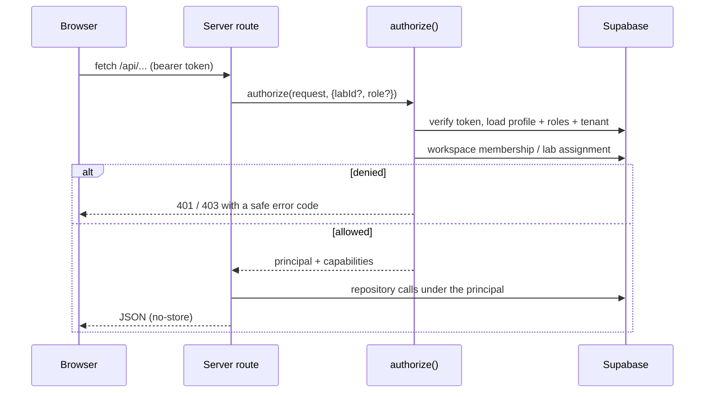
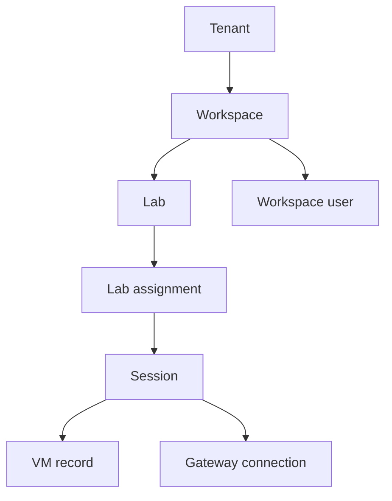
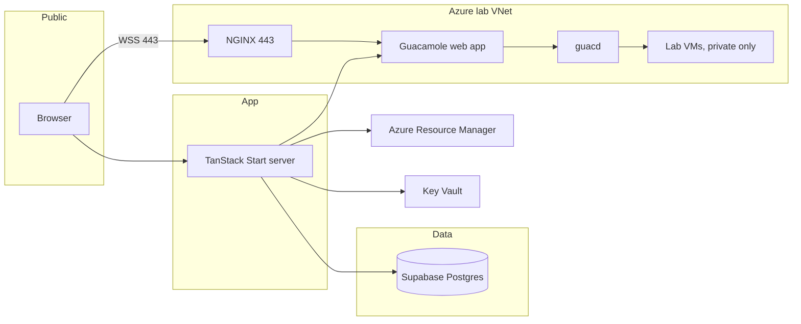

# Architecture

## Layers

| Layer | Location | Responsibility |
| --- | --- | --- |
| UI | `src/routes/*.tsx`, `src/components/**` | Admin console and learner experience |
| API | `src/routes/api/**` | Server routes; every privileged operation |
| Security | `src/lib/security/**` | Identity, authorization chain, secrets, Key Vault |
| Data | `src/lib/db/*.repo.server.ts` | Supabase repositories, no business logic in routes |
| Cloud | `src/lib/cloud/**`, `src/lib/vm/**` | Connections, controller, providers, pool, reaper |
| Gateway | `src/lib/remote-desktop/**` | Guacamole brokering, simulated desktop |
| Realtime | `src/lib/realtime/**` | Server event bus + SSE to the browser |

## Request and auth flow

## Tenant isolation

Every hop is re-checked server-side; a client-supplied id can only narrow access,
never widen it. RLS enforces the same boundary at the database.

## Deployment topology

