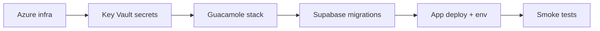

# Deployment

## Environments

| Environment | VM provider | Desktop | Secrets |
| --- | --- | --- | --- |
| development | mock | simulated | environment |
| staging | Azure (test subscription) | Guacamole | Key Vault |
| production | Azure | Guacamole | Key Vault |

`SKILLTRACK_ENV` selects the mode. Staging and production refuse to downgrade to
mocks unless `ALLOW_MOCK_FALLBACK=true`, which is reported as degraded in health.

## Components to deploy

1. **App** — TanStack Start server build (`npm run build`) on a Node/edge host with a
   managed identity that can read Key Vault and manage the lab resource group.
2. **Database** — Supabase project per environment; migrations applied ([database.md](database.md)).
3. **Azure resources** — resource group, VNet/subnet, NSG, Key Vault, Log Analytics,
   image gallery, pool VMs ([../infra/README.md](../infra/README.md), [azure-setup.md](azure-setup.md)).
4. **Guacamole** — Compose stack from `deploy/guacamole`, inside or peered to the lab VNet,
   publishing only 443.

## Order of operations

## Configuration

Every variable is listed in `.env.example`. In staging/production the sensitive
ones come from Key Vault; the host only needs `AZURE_KEY_VAULT_URI`,
`SKILLTRACK_ENV`, the Supabase URLs and the non-secret Azure/gateway settings.

Follow [runbooks/deploy.md](runbooks/deploy.md) for the actual release.
