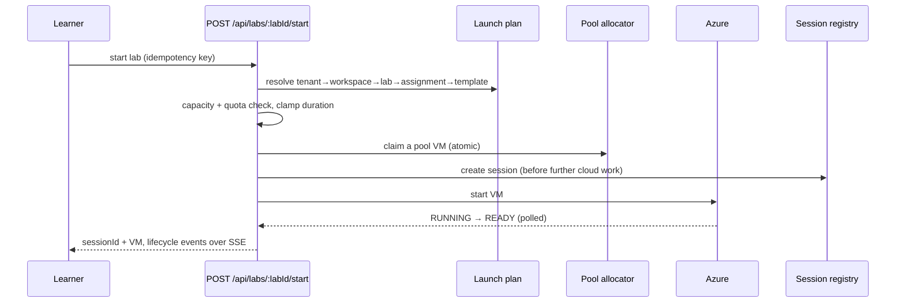
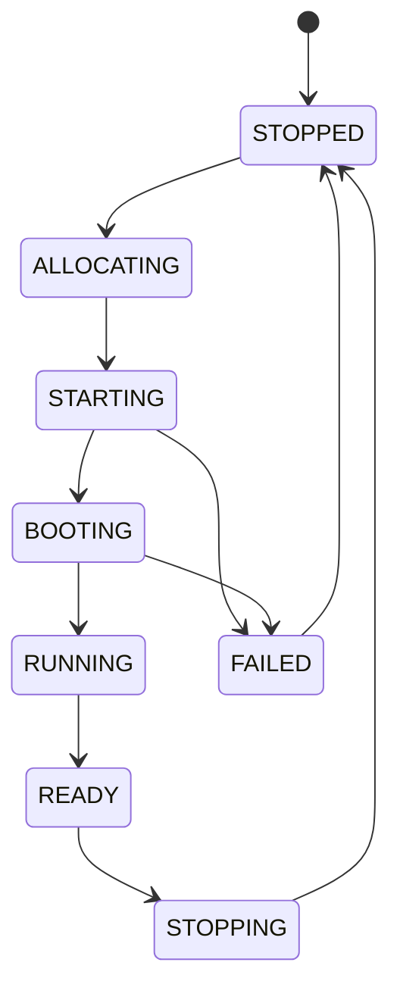
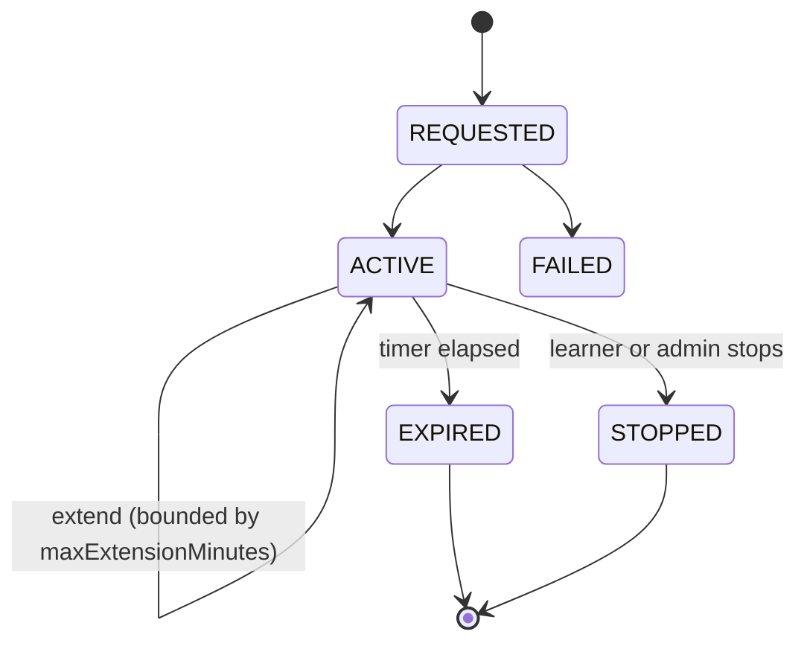
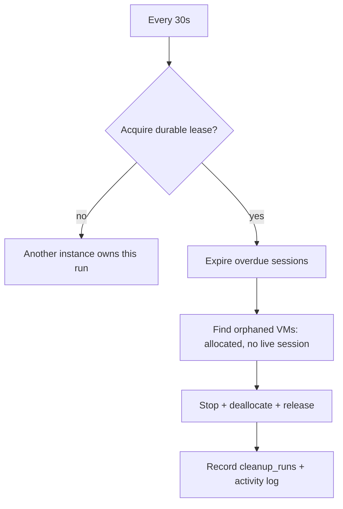

# Lab lifecycle

## Launch sequence

A repeated POST with the same idempotency key — or any live session for the same
learner and lab — returns the existing session instead of provisioning again.
A failure part-way through compensates: session failed, VM stopped and released.

## VM state machine

## Session state machine

## Teardown order

Gateway connection and ephemeral user → VM stop/deallocate → pool release →
session marked stopped/expired → audit entry. The reaper repeats this for anything
left behind.

## Cleanup / reaper

