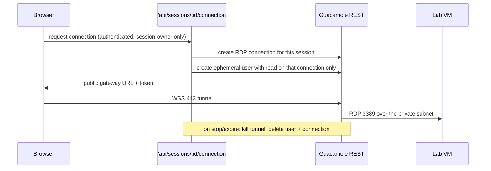

# Remote desktop (Apache Guacamole)

## Isolation

Each session gets its own connection object and its own throwaway account.
Changing a VM or connection id in the URL grants nothing. RDP credentials are
injected server-side from Key Vault and never reach the browser.

## Configuration

`GUACAMOLE_URL` (internal), `GUACAMOLE_PUBLIC_URL` (HTTPS, browser-facing),
`GUACAMOLE_USERNAME` / `GUACAMOLE_ADMIN_PASSWORD`, `GUACAMOLE_DATA_SOURCE`,
`GUACAMOLE_SHARED_SECRET`, `LAB_VM_USERNAME` / `LAB_VM_PASSWORD` / `LAB_VM_DOMAIN`,
`LAB_RDP_SECURITY`, `LAB_RDP_IGNORE_CERT`, `LAB_CLIPBOARD`, and the two timeout
budgets. Startup validation errors in a live environment if the public URL is not HTTPS.

## Connection states

`CONNECTING → CONNECTED`, with `DISCONNECTED` and `ERROR` terminal states surfaced
in `RemoteDesktopViewport`. `DISABLE_REMOTE_DESKTOP=true` or development mode
serves the simulated desktop instead.

In staging and production the platform never downgrades silently: if the gateway is
not configured, brokering fails with `GATEWAY_NOT_CONFIGURED` and the learner sees a
clear "gateway not available" message. A simulated desktop always carries a visible
"Development desktop — not a real machine" badge, and a real tunnel is labelled
"Secure gateway · HTTPS/WSS".

## Health and validation

- **Remote Desktop Health panel** — `/admin/cloud/vm-pool` shows gateway configuration,
  reachability, service-account acceptance, guacd/RDP protocol support, HTTPS on the
  browser-facing URL, clipboard policy, RDP credential presence, timeout budgets and the
  outcome of the most recent RDP test. Data comes from `GET /api/admin/cloud/gateway-health`
  (admin/superadmin only) and contains no addresses or credentials.
- **Per-VM "Test RDP"** — the VM Pool row action runs the full checklist server-side:
  registration, Azure power state, private address, gateway configuration, gateway
  reachability, RDP credentials, then a real brokered test connection plus a scoped
  ephemeral account, which are both deleted afterwards. Failure to delete either object is
  reported as a failed check. Each run is written to the cloud audit trail and the activity
  feed (`admin.test-rdp`).
- **Cleanup safety net** — brokered connections are recorded in `gateway_connections`; the
  reaper terminates and marks any record whose session is no longer live or whose tunnel has
  expired.

### Verify

1. Open `/admin/cloud/vm-pool` and confirm the health panel reports the expected mode.
2. Stop the Guacamole container: the panel must flip to "gateway degraded" with a failing
   reachability check, and a learner launch must fail visibly rather than simulate.
3. Run "Test RDP" on a running machine — all checks pass and the gateway shows no leftover
   `skilltrack-test-*` connection or `stl-test-*` user.

## Deployment

Topology, Compose stack, TLS, database init, service account and scaling notes live
in [../deploy/guacamole/README.md](../deploy/guacamole/README.md) and
[deployment.md](deployment.md). Failures: [runbooks/gateway-failures.md](runbooks/gateway-failures.md).
